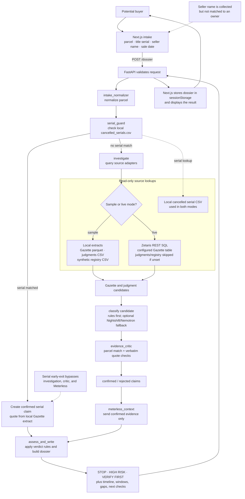
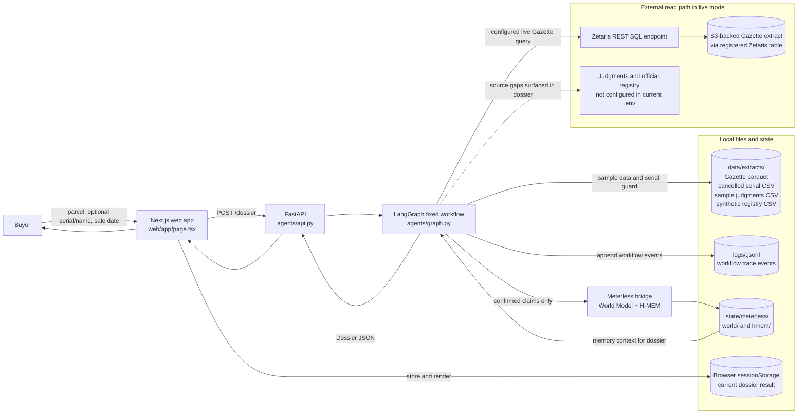

# Agentic implementation findings and draft plan

**Status:** Feasibility draft, 27 October 2026
**Branch:** `agent-draft`
**Scope:** Findings from the current repository and a staged proposal for more autonomous land due-diligence agents. This document does not claim integration access to any government registry.

## Executive summary

The current application is an evidence-led, mostly deterministic workflow. It can identify candidate Gazette and court records, validate some claims against parcel text and verbatim source excerpts, and produce a rule-based verdict. Meterless records evidence patterns after claim validation. The implementation does not currently verify the seller against a live official land register.

The recommended next step is to make evidence and source coverage transparent, then build an assisted ownership check around an official search result. For this implementation, the buyer or authorized admin obtains the paid, MFA-gated Ardhisasa result directly; the agent only analyzes the supplied result. Direct portal automation is out of scope. The public portal and user guidance do not establish a third-party API contract.

A user-supplied Nairobi cadastre ZIP has been inspected at the archive and schema level. Its polygon and polyline layers could improve parcel identity resolution and spatial checks, but the map is not in the repository or connected to runtime. Its publisher, license, date, and coverage still need confirmation before implementation.

## What the current implementation reads

### Current local configuration

The repository-root `.env` currently sets `SAMPLE_MODE=false` and configures `land_files.gazette_notices_agent` as its Zetaris notices table. The judgments and registry table settings are blank. Secrets are intentionally not reproduced here.

### Source inventory

| Input | Current implementation | Runtime status / caveat |
|---|---|---|
| Kenya Gazette land notices | `data/extracts/gazette_notices.parquet` in sample mode; `land_files.gazette_notices_agent` in live mode. The extractor stores notice IDs, raw text, parcel references, and a `source_url`. | Live notices table is configured. The repository’s documented extract covers Gazette issues from 2022–2024, so absence from it is not proof that no notice exists outside that period. |
| Cancelled title serials | `data/extracts/cancelled_serials.csv` is loaded locally in both modes. It is derived from Gazette Notice 12436. The fast guard can return STOP before any Zetaris query. | Available locally, not a live serial-list query. The serial guard directly creates a confirmed claim; ensure its notice ID, matched range, excerpt, and source are validated together. |
| Environment and Land Court judgments | `data/extracts/judgments.csv` in sample mode, built from 14 selected Kenya Law decisions. | No live judgments table is configured. The sample is curated and small, not comprehensive. |
| Registry | `data/extracts/synthetic_registry.csv` in sample mode; each row is synthetic. | No live registry table is configured. It must never be presented as an official ownership check. |
| Seller details | Buyer can enter a seller name in the web form. | The current agent does not compare it to a registry proprietor. Avoid collecting identity data until there is an approved purpose, consent flow, and retention policy. |
| Survey/cadastre data | No active adapter. A user-supplied Nairobi cadastre ZIP has now been inspected at the archive/header level; it has not been extracted, added to the repository, or connected to runtime. | It contains polygon and polyline layers and useful parcel identifiers. Provenance, date, coverage, and license still need confirmation; see the map assessment below. |

The live Zetaris client is read-only and executes SQL through the configured Zetaris endpoint. It does not itself ingest or update source data. See `agents/sources.py`, `agents/config.py`, `data/scripts/`, and the source table in `README.md`.

## Current implementation diagrams

These diagrams describe the code that exists today, not the proposed expanded agent architecture below. The graph is a fixed workflow with conditional routing; several graph nodes are deterministic functions rather than independent, self-directed agents.

### Request workflow

### Components and data stores

### Current graph nodes

| Node/component | What it does | Data interaction and limits |
|---|---|---|
| `intake_normalizer` | Normalizes the parcel input and initializes graph state. | Receives all intake fields; seller name is not used for owner matching. |
| `serial_guard` | Checks title serial against local cancelled-serial CSV. | A match creates a confirmed claim directly and routes to assessment; it does not pass through the evidence critic or Meterless. |
| `investigate` | Calls the notice, judgment, and registry adapters in sequence. | Sample mode reads local extracts. Live mode reads configured Zetaris tables; currently only Gazette is configured. It logs a `court_investigator` delegate event, but does not start a separate court-agent process. |
| `classify` helper | Applies text rules first; if no rule matches and a runtime token is configured, requests a bounded classification from Nightshift/Nemotron. | Classification proposes a claim kind; it does not confirm the claim or decide the verdict. |
| `evidence_critic` | Checks parcel identity and verifies a quote against the candidate source text. | Sets claim status to confirmed or rejected and emits trace events. |
| `meterless_context` | Sends critic-confirmed evidence to the local Meterless bridge. | World Model and H-MEM persist/retrieve source relationships and patterns. Memory cannot create evidence; its summaries may be included in advocate-review notes. |
| `assess_and_write` | Applies fixed verdict and objection-window rules, then assembles the dossier. | STOP for a cancelled serial, a recent confirmed Gazette lost-title claim, or a confirmed court order; HIGH RISK for other confirmed claims; otherwise VERIFY FIRST. |
| FastAPI + Next.js | Validates the intake, returns the dossier, and renders it. | The web client falls back to mock data on request failure and marks the result as demo data. Dossier state is stored in browser session storage. |

The current trace is operational logging, not the evidence presented to the buyer. For each finding, the dossier should carry source locators and excerpts independently of trace events.

## External source feasibility

Publicly viewable pages and documents do not by themselves imply an API, stable automated access, or permission to scrape. Before building each connector, confirm the source’s terms, rate limits, data reuse rights, supported access method, and any authentication requirements.

| Candidate source | Potential use | Feasibility assessment |
|---|---|---|
| [Kenya Law Gazette archive](https://kenyalaw.org/gazettes/) | Gazette issue pages and issue PDFs; extract notices, source IDs, text, and source URLs. | Existing scripts already list issues and download PDFs with a delay. This is the clearest available ingestion path, but it is a website/PDF workflow, not a confirmed API. Keep the current respectful rate limiting and record failures. |
| [Kenya Law judgments](https://new.kenyalaw.org) | Environment and Land Court decisions and other relevant judgments. | Repository tooling fetches a hand-picked set of pages. A wider search API or bulk feed has not been verified. Build only from documented/authorized interfaces and preserve decision URLs, court, case number, date, and paragraph/page anchors. |
| [Ardhisasa](https://ardhisasa.lands.go.ke/home) | Official search for registered proprietor and registered interests. | **Human/admin-only boundary for this implementation.** Per the product owner's workflow constraint, searches are fee-bearing and MFA-gated; an authorized buyer/admin accesses the portal directly, completes payment and MFA there, and obtains the official result. The agent does not log in, handle OTPs, make payments, or scrape authenticated pages. No public third-party developer API documentation was identified in the official material reviewed. Any future official API proposal requires a separate authorization, security, and privacy review; it is not an assumed dependency. |
| [State Department search certificate](https://lands.go.ke/issuance-search-certificate) | Official current register details and encumbrances. | The State Department describes the certificate as a direct registry search for ownership status and encumbrances and currently lists a KSh 1,000 charge. The buyer or authorized admin obtains the paid result directly and supplies it to the app for assisted extraction/comparison; recheck the fee through the official channel at the time of search. An upload is sensitive data and needs explicit consent, encryption, limited access, and deletion controls. |
| State Department survey search / Nairobi cadastre | Plans, dimensions, survey numbers, beacons, and parcel geometry. | Potentially useful for resolving parcel identity and comparing boundaries, but does not establish registered ownership. The supplied map is a shapefile with a declared projection and parcel-ID fields; its provenance, license, date, coverage, and authoritative status remain unconfirmed. Direct access to official survey records is also unconfirmed. |
| General web search / third-party property pages | Discovery leads only. | Do not treat scraped listings, blogs, or name matches as proof of ownership. They can generate leads for primary-source searches, clearly labeled as unverified. |

The Land Registration Act describes the register and official searches, and treats a certificate of title as prima facie evidence of proprietorship subject to statutory exceptions. This supports using official registry evidence as the ownership source of record, not substituting a model’s inference for it. See [Land Registration Act](https://new.kenyalaw.org/akn/ke/act/2012/3/~part_VII__sec_71__subsec_3) and [Land Registration (General) Regulations, official search](https://new.kenyalaw.org/akn/ke/act/ln/2017/278/eng%402017-11-24/source).

## Nairobi cadastre map assessment

The user supplied `NEW NAIROBI CADASTRE PROJECTED.zip`. Inspection was limited to ZIP entries and shapefile headers/DBF schemas; no feature/owner values were read. The archive is about 46.6 MB and contains about 2.35 GB uncompressed.

| Layer | GIS structure | Records | Useful fields / observations |
|---|---|---:|---|
| `NLIMS PARCELS` | ESRI Shapefile polygon layer (shape type 5) with `.shp`, `.shx`, `.dbf`, `.prj`, `.cpg`, `.sbn`, and `.sbx` files. | 247,119 | Includes `fr_number`, `rim_name`, `lr_number`, `parcel_num`, `sheet_numb`, `reg_block`, `block_name`, `county`, and `sub_county`. The DBF also has an `owner` field; treat its values as potentially personal data and do not ingest them for the initial geometry/parcel-ID prototype. |
| `PARCEL POLYLINES` | ESRI Shapefile polyline layer (shape type 3) with corresponding sidecars. | 215,310 | Includes `fr_number`, `lr_number`, `parcel_num`, `floor_numb`, `house_numb`, `reg_block`, `block_name`, and `county`; it also has an `owner` field. |

Both layers declare WGS 84 / UTM Zone 37S in their `.prj` and have matching bounds of approximately 240,118–289,103 m easting and 9,846,345–9,871,614 m northing. This is consistent with a Nairobi-area projected extent, but header bounds alone do not prove the data is authoritative or complete for Nairobi. The archive contains no source/date/license metadata file; those facts must be obtained from the provider.

The structure is technically suitable for a parcel matching prototype: normalize `lr_number`, `parcel_num`, `fr_number`, and block/RIM identifiers, then join to polygon geometries and spatially index only the needed records. Before production use, confirm publisher/authority, license or permission, publication/revision date, coverage, field definitions, and whether geometry is authoritative or indicative. Test parcel joins against independently checked examples, including aliases and duplicate identifiers.

Do not use geometry alone to infer owner, title validity, or a legal boundary determination. Keep the original archive outside Git (the expanded data is large), remove GIS lock files from any processing copy, and preserve the source version and geometry provenance for each result. Exclude the `owner` field unless its use has a documented lawful basis, explicit purpose, access controls, and retention policy.

## Citation and explanation design

The current dossier includes claim kind, parcel, quote, source type, source ID, and status. Gazette raw records already carry `source_url`, but that URL is not carried into the API claim contract or rendered as a link. Add an evidence reference that preserves:

- Stable source ID, source authority/type, title/case/notice number, publication date, source URL, and retrieved-at timestamp.
- Immutable source snapshot hash/version and extraction method/version.
- Exact quote plus page/paragraph or character offsets to highlight it in the source excerpt.
- Parcel/serial match method and matched fields; distinguish exact match, normalized alias, and text-only candidate.
- Evidence status (`confirmed`, `unverified`, `rejected`) and, for rejected items, the reason.
- The explicit verdict rule that used the confirmed claim(s); keep model prose separate from the rule output.

In the UI, render inline numbered citations. Hover/focus may show a short preview; click opens a keyboard-accessible evidence card with context surrounding the verbatim quote, highlighted matching text, source metadata, and an external-source link where available. Provide an open-source action and a clear message when a source PDF/link is unavailable. Never rely on hover alone. Escape/sanitize source content and treat downloaded documents as untrusted input.

Each verdict should identify its contributing evidence and rule, then list searches not completed or sources unavailable. “No match found in the sources searched” must not be presented as proof of clean title or ownership.

## Agentic architecture proposal

Use bounded, inspectable graph nodes rather than one unconstrained agent:

1. **Intake and parcel resolver:** normalize parcel/title formats, use the cadastre only where its scope/provenance is known, return candidate identities when ambiguous.
2. **Search planner:** produce a structured, allow-listed query plan for registered source connectors; enforce source, request, time, and result limits.
3. **Source investigators:** run independent Gazette, court, and authorized survey-source tasks. Ownership evidence enters through the official search result supplied by a buyer/admin; there is no direct Ardhisasa login or connector in this plan. Parallelize independent read-only lookups.
4. **Document extractor:** propose structured claims from PDFs/pages with exact quote spans and source anchors. LLM extraction may propose evidence; it cannot confirm it.
5. **Evidence verifier/critic:** deterministic parcel identity check, date and source validation, verbatim quote check, duplicate/contradiction handling, and freshness/authority classification.
6. **Ownership reconciler:** compare a buyer-supplied official search and title particulars with the parcel and seller-provided details; minimize PII and report mismatches rather than pronounce legal validity.
7. **Adversarial reviewer:** look for parcel collisions, stale/contradictory records, missing sources, and alternative interpretations. It can force abstention/escalation, not override evidence rules.
8. **Risk policy and dossier writer:** deterministic verdict rules consume only verifier-approved evidence. The writer explains the rule with citations and coverage limits.
9. **Follow-through coordinator:** prepares official-search and advocate/survey checklists and tracks missing documents; no transaction approval or filing/payment actions.

Meterless World Model/H-MEM can continue to store relationships/patterns derived from critic-confirmed claims. Memory is context for investigating or explaining; it is not a source of new factual claims and must never independently change a verdict.

## Ownership verification workflow

### Near-term assisted ownership check

1. The buyer or authorized admin performs the paid search directly in Ardhisasa and completes MFA outside this product.
2. The buyer/admin obtains the official result and provides it through a consented, secure handoff/upload. Do not request or store Ardhisasa login credentials or OTPs, initiate payment, or automate the logged-in portal.
3. Extract proprietor(s), parcel/title identifiers, tenure, encumbrances/restrictions/cautions/charges, and pending applications where present.
4. Compare those values with the buyer's parcel, supplied title particulars, and seller name. If identity comparison requires national ID data, scope and retention must be explicit; ideally use a privacy-minimized match and delete the raw ID after comparison.
5. Mark the document as buyer/admin-supplied until authenticity is checked through an official verification mechanism. Show mismatches and missing fields for advocate review.
6. Keep physical possession, site boundaries, and questions of legal authority in the unresolved checklist unless an appropriately qualified source/process verifies them.

The product should record that the official-search step was completed by a human/admin, when the result was issued, and which file/result was analyzed. The application should not imply that it itself accessed Ardhisasa or paid for the search. If no official result is supplied, ownership verification remains explicitly incomplete.

### Autonomy boundary

Automate retrieval, deduplication, parsing, cross-document matching, citation, completeness checks, and follow-up reminders. Do not claim the system proves that a seller is legally entitled to sell or that the physical land matches the register unless that result comes from an authoritative verification process. The Act identifies title as prima facie evidence and recognizes exceptions; legal interpretation and contested facts should be routed for qualified review.

## Recurring system evaluation

The current `eval/run_cases.py` and `eval/cases.yaml` are a starting harness, not a production self-certification system. Extend them into scheduled and event-triggered evaluation:

- **Triggers:** nightly/weekly run; every parser, rule, prompt/model, or source-corpus change; and before release.
- **Golden set:** human-adjudicated, versioned cases covering each claim type, parcel aliases/collisions, ambiguous matches, source conflicts, stale data, malformed documents, and no-evidence cases. Keep an untouched holdout set.
- **Evidence gates:** exact quote-to-snapshot match, citation completeness, parcel precision, expected evidence IDs, dates/windows, duplicate handling, and no confirmed unsupported claims.
- **Outcome gates:** verdict accuracy and false-negative/false-positive rates per claim type; safe abstention when sources are missing, stale, or contradictory.
- **Operational gates:** source freshness/coverage, ingestion/extraction failures, connector errors, rate limits, response latency, and browser/API mock-fallback rate.
- **Independent review:** periodically blind-audit randomly sampled dossiers with an advocate/qualified reviewer. Use a second model as a diagnostic only, not the sole judge.
- **Versioned report:** record code, model/prompt/rules, source snapshot hash, evaluation set version, metric deltas, and failures; keep PII and secrets out of logs.
- **Safe action:** alerts and blocks promotion or quarantines a failing parser/source path. No autonomous prompt/rule/model self-modification or automatic deployment based only on its own score.

## Phased delivery and acceptance criteria

### Phase 0 — Source inventory and trust labeling

- Publish an in-product source coverage panel: source name, live/sample/synthetic, coverage range, last successful retrieval, and missing connectors.
- Remove silent mock fallback or require a prominent demo-data banner with retry/error details.
- Add tests for serial-to-notice linkage and no-source/connector-failure abstention.

**Accept when:** a buyer can tell exactly which data sources ran, which did not, and whether results are live, sample, synthetic, or stale.

### Phase 1 — Evidence citations and verdict reasons

- Extend claim/API schema to carry source URL, authority, publication/retrieval dates, source snapshot/hash, excerpt anchors, match basis, and verdict rule references.
- Render citation cards and a “Why this verdict?” section with highlighted excerpts and explicit search coverage.

**Accept when:** every confirmed claim and every verdict reason opens its exact source evidence or shows why it cannot; excerpts are byte/text-verifiable against preserved source snapshots.

### Phase 2 — Broaden public-source ingestion

- Expand Kenya Gazette collection with respectful rate limits, retries, source snapshot checksums, and parser quality metrics.
- Expand Kenya Law judgments only through a verified permissible interface; record source IDs and exact paragraph anchors.
- Add relevant official public notices and survey sources only after source ownership/access/terms are confirmed.

**Accept when:** every connector has an approved access method, provenance fields, coverage/freshness limits, and parser regression cases.

### Phase 3 — Cadastre and assisted official-search matching

- Confirm the supplied Nairobi map's authority, license, date, coverage, and field definitions; then build an isolated import/validation spike using only the necessary non-owner fields.
- Add secure official-search document intake and deterministic field comparison. The buyer/admin completes the paid Ardhisasa search and MFA directly; do not build portal automation or a direct connector under this plan.

**Accept when:** map matching reports source/coverage uncertainty; official-search ownership comparison cites document fields; no synthetic row is represented as a real registry result.

### Phase 4 — Bounded orchestration and exception handling

- Decompose current graph into explicit search/extraction/verification/reconciliation/review nodes; allow only registered read-only tools.
- Add budgets, timeouts, retries, idempotency, audit events, and escalation reasons.

**Accept when:** every agent action has an auditable tool/source record; claims cannot bypass verification; memory cannot create claims or verdicts.

### Phase 5 — Continuous evaluation and operations

- Schedule the expanded evaluation suite and source-health checks; publish result deltas and notify maintainers on regressions.
- Gate releases or quarantine degraded source connectors.

**Accept when:** a source or parser regression is detected before it can silently change buyer-facing results; rollback is documented and exercised.

## Open dependencies

1. Obtain the Nairobi cadastre publisher/authority, license, revision date, coverage, and field definitions; the supplied ZIP does not include this metadata.
2. Define which buyer/admin role performs the Ardhisasa search, how the result is securely handed to the application, and how the product records source, issue date, consent, and deletion. Direct agent access remains out of scope unless the product owner revisits this boundary and an official integration is authorized and separately reviewed.
3. Decide who may upload official-search certificates, how identity fields are handled, and retention/deletion periods.
4. Confirm permitted automated retrieval and reuse terms for Kenya Law Gazette and judgment content at the scale intended.
5. Expand the human-reviewed evaluation set before broadening sources or changing verdict policy.
